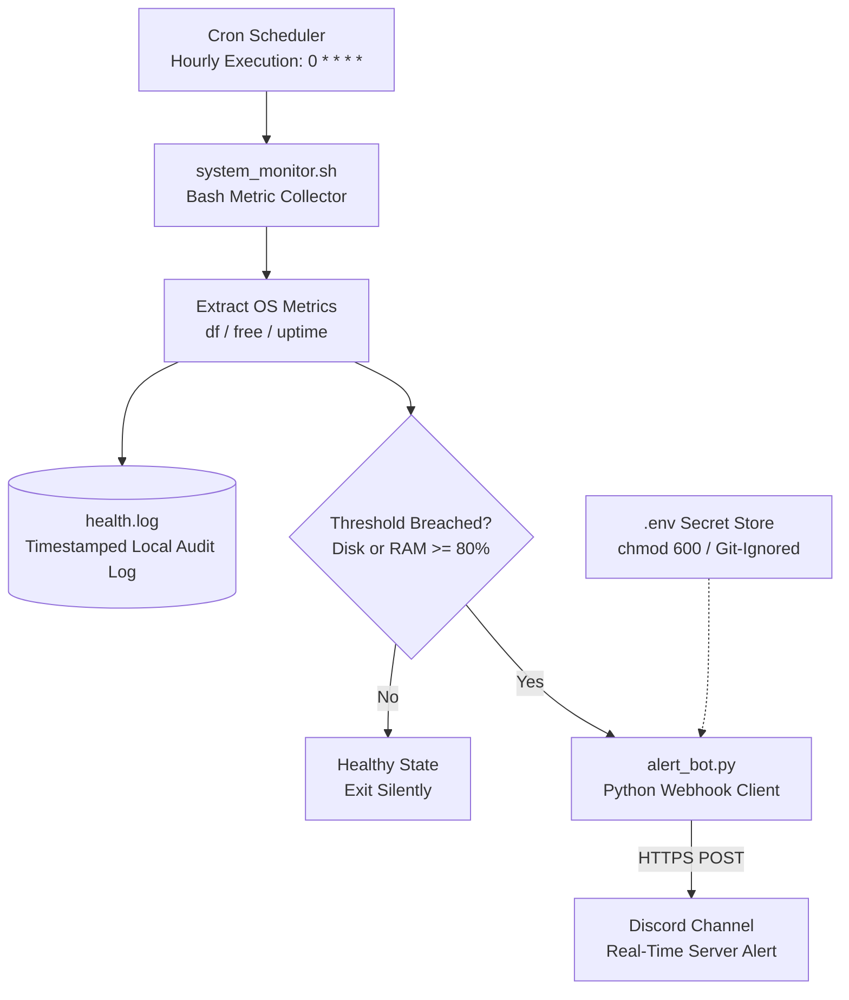

# Linux Health Monitor (AWS EC2)


A lightweight, automated Linux infrastructure monitoring and alerting system deployed on **AWS EC2 (Ubuntu 24.04 LTS)**. Designed to run continuously via `cron`, it extracts real-time CPU, memory, and disk metrics, maintains timestamped local audit logs, and triggers instant **Discord Webhook** notifications whenever resource utilization breaches defined thresholds.

---

## System Architecture



---

## Key Features & Engineering Highlights

* **Zero-Agent Metric Collection:** Uses native Linux utilities (`df`, `free`, `uptime`, `awk`, `sed`) inside Bash to extract root partition usage, RAM utilization percentage, and 1-minute CPU load averages with minimal compute overhead.
* **Dynamic CLI Threshold Overrides:** Defaults to `80%` thresholds for production cron runs while accepting optional positional arguments (e.g., `./system_monitor.sh 1 1`) to simulate resource spikes and verify end-to-end alerting without editing code.
* **Secrets Hygiene & Access Control:** Isolates the Discord Webhook URL inside a local `.env` file restricted with Discretionary Access Control (`chmod 600 .env`) and excluded via `.gitignore`. A sanitized `.env.example` template is provided for safe reproducibility.
* **Cron-Safe Execution:** Built with explicit absolute paths (`/usr/bin/python3`, `$HOME/health-monitor`) so automated background jobs execute reliably inside `cron`'s restricted environment.

---

## Tech Stack

| Layer | Technology | Role |
| :--- | :--- | :--- |
| **Cloud Infrastructure** | AWS EC2 (`ap-southeast-1`, Ubuntu 24.04) | 24/7 cloud Linux host |
| **Metric Collection** | Bash, `df`, `free`, `uptime`, `awk` | Extracts OS telemetry & evaluates thresholds |
| **Alerting Engine** | Python 3, `requests`, `os`, `sys` | Loads `.env` credentials & dispatches webhook payloads |
| **Automation** | Linux `cron` | Schedules unattended hourly health checks |
| **Security & VCS** | `chmod`, `.env`, `.gitignore`, Git | Protects credentials and manages version control |

---

## Repository Structure

```text
linux-health-monitor/
├── system_monitor.sh   # Core Bash script for telemetry extraction, logging, and threshold checks
├── alert_bot.py        # Python module for reading .env secrets and sending Discord alerts
├── .env.example        # Sanitized environment variable template
├── .gitignore          # Excludes local .env credentials and health.log runtime logs
└── README.md           # Project documentation and architecture overview
```

---

## Deployment & Setup

### 1. Clone the Repository
```bash
git clone [https://github.com/Deerence/linux-health-monitor.git](https://github.com/Deerence/linux-health-monitor.git)
cd linux-health-monitor
```

### 2. Install Dependencies
```bash
sudo apt update && sudo apt install -y python3-requests
```

### 3. Configure Secrets (Owner-Only Permissions)
Copy the template file, insert your Discord Webhook URL, and restrict file access to the owner:
```bash
cp .env.example .env
nano .env   # Replace placeholder with your Discord Webhook URL
chmod 600 .env
```

### 4. Make Executable & Run a Test Alert
Pass `1 1` as arguments to temporarily lower both thresholds to 1% and verify the Discord integration:
```bash
chmod +x system_monitor.sh
./system_monitor.sh 1 1
```

### 5. Schedule Hourly Automation via Cron
```bash
(crontab -l 2>/dev/null; echo "0 * * * * $HOME/linux-health-monitor/system_monitor.sh") | crontab -
```

---

## Live Output & Alert Proof

**Sample `health.log` entry:**
```text
[2026-11-19 14:00:01] Host: ip-172-31-xx-xx | CPU Load: 0.08 | Memory: 24% | Disk: 31%
```

**Discord Alert Notification:**


---

## Planned Enhancements

* **Log Rotation:** Configure `logrotate` to archive and compress `health.log` weekly to prevent unbounded disk growth.
* **Service Health Checks:** Extend `system_monitor.sh` to verify critical `systemd` daemons (e.g., `ssh`, `cron`) and report inactive services.
* **Containerization:** Package the Python alerter and monitoring loop with Docker for portable deployment across multiple nodes.
